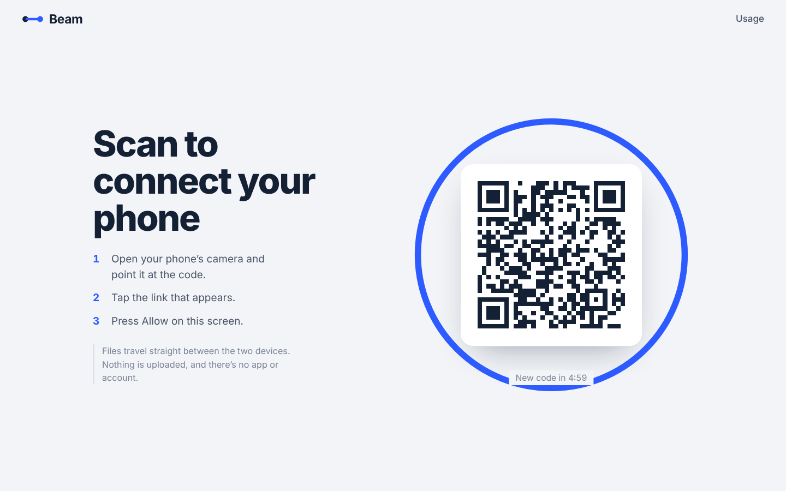
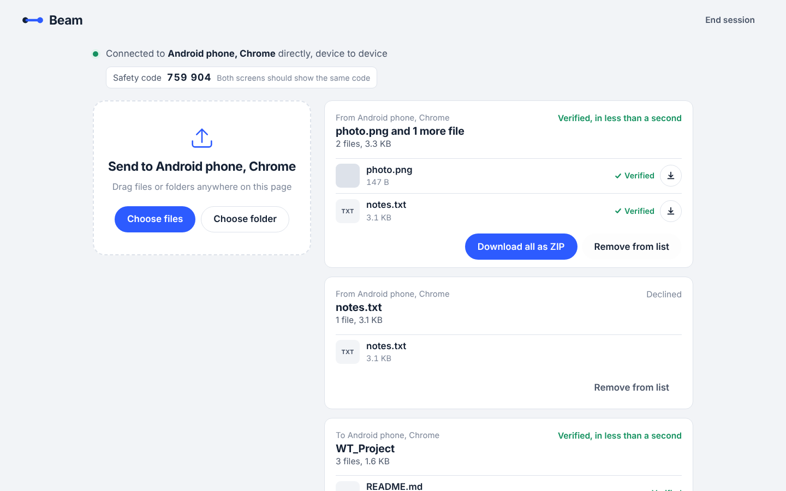
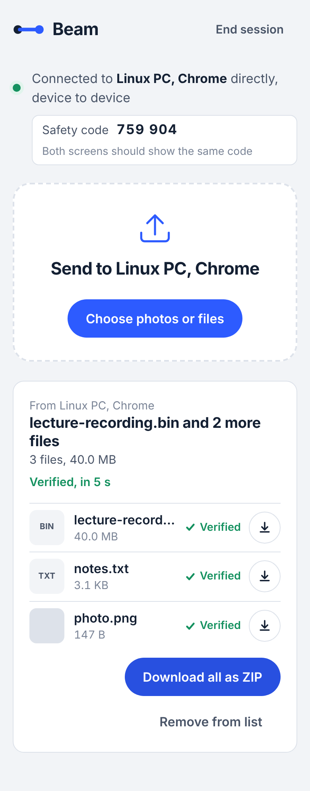
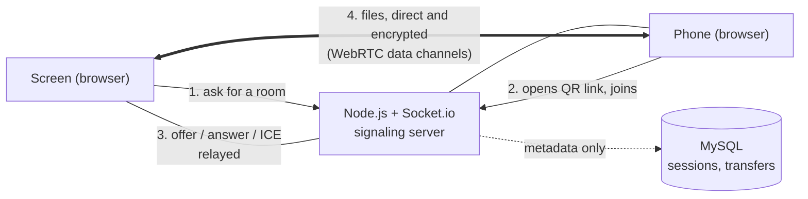
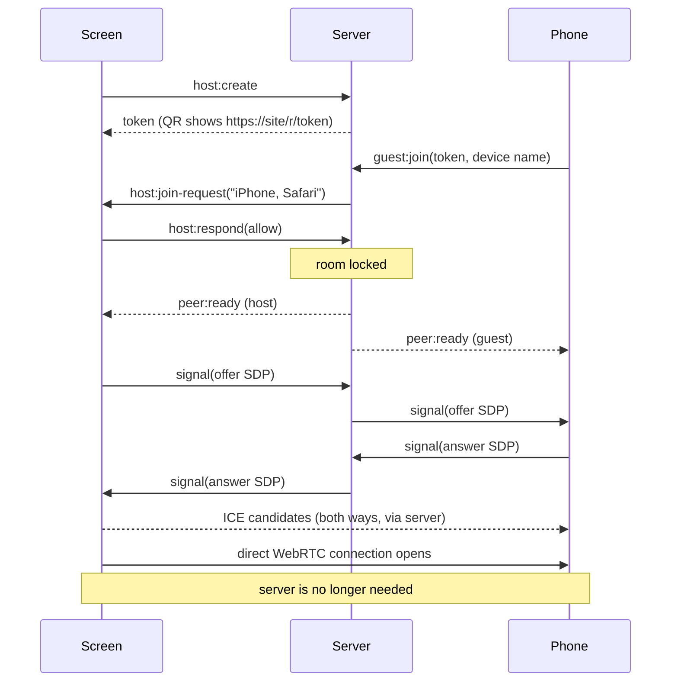

# Beam

**Instant QR-based peer-to-peer file sharing between devices using WebRTC.**

Open Beam on a computer and it shows one QR code. Scan it with a phone camera, press **Allow**, and the two devices are connected. Files then travel **directly from one browser to the other**. They never pass through or get stored on a server. No app to install, no login, works across Android, iPhone, Windows and Mac.



> **Web Technologies (CS3111) course project, Vishwakarma Institute of Technology, Pune**

---

## Features

| | |
|---|---|
| **One QR, no typing** | The screen shows a single QR code. The phone's normal camera opens it in the browser. |
| **Approval + room lock** | The screen must press Allow before a phone connects. After pairing the room locks, so other people who scan the projected code are turned away. |
| **One-time, expiring codes** | Each QR holds a 24-character random token. It expires after 5 minutes and a fresh one appears; used codes stop working. |
| **Safety code** | Both devices show a 6-digit code made from their encryption keys. Matching codes prove nobody, not even the server, is in the middle. |
| **Direct transfer (P2P)** | WebRTC data channels carry files device to device. Stopping the server mid-transfer doesn't interrupt it. |
| **Both directions at once** | Two pre-agreed channels (one per direction), so the phone and the screen can send at the same time. |
| **Many files and folders** | Multi-select, folder picker, and drag-and-drop of whole folders. Folder structure is kept. |
| **Accept or decline** | The receiver sees what's coming (count, size, names) before anything transfers. |
| **Integrity check** | Each file's SHA-256 fingerprint is computed while sending and while receiving. A match shows **Verified**. |
| **Live progress** | Per-file and overall progress, speed and time remaining. Either side can stop a transfer. |
| **ZIP download** | Download everything as one ZIP with folders intact, or single files. Image thumbnails for photos. |
| **Survives network blips** | If the server connection drops, the device rejoins its session automatically (30-second grace). If the direct link drops, Beam renegotiates a new route (ICE restart) and transfers carry on. |
| **Screen stays awake** | Uses the Wake Lock API so a phone doesn't lock itself mid-transfer. |
| **Works on hard networks** | Google STUN by default; optional free TURN relay (encrypted end to end) for networks that block direct links. |
| **Usage dashboard** | `/stats` shows data moved, sessions, overall speed and recent transfers, from MySQL. Metadata only, behind an admin password (signed HttpOnly cookie, login attempts rate-limited). |

| Screen after pairing | Phone after receiving |
|---|---|
|  |  |

---

## Tech stack (all free)

| Layer | Technology | Syllabus unit |
|---|---|---|
| UI | React 19 + TypeScript (Vite), React Router | II, V |
| State | Custom hooks (`useBeamSession`), external store with `useSyncExternalStore` | V |
| Server | Node.js + Express (REST API, static files) | VI |
| Real-time signaling | Socket.io | VI |
| File transfer | WebRTC data channels (built into browsers) | — |
| QR / ZIP / hashing | `qrcode`, `jszip`, `hash-wasm` (SHA-256) | — |
| Database | MySQL via `mysql2` (falls back to memory if not configured) | VI |
| API testing | Postman collection in `postman/` | IV |
| End-to-end testing | Playwright (two real browsers) in `tests/` | — |
| Hosting | Render free tier (automatic HTTPS) | — |

---

## How it works



**Pairing and connection handshake**



**File transfer protocol** (over the data channel)

1. Sender → `offer` with every file's name, folder path, size and type.
2. Receiver → `reply` accept or decline.
3. For each file: `file` → binary chunks (64 KB) → `file-end` with SHA-256.
4. Sender → `done`; receiver → `complete` with the verification result, and logs the transfer's metadata to the server.

Large files are read 1 MB at a time and the sender pauses when the browser's send queue goes above 8 MB, so memory stays flat even for big videos. Received files are held in browser memory, so one transfer is capped at 2 GB.

---

## Run it locally

Requires **Node.js 18+**.

```bash
git clone https://github.com/<your-username>/beam-p2p.git
cd beam-p2p
npm install          # installs root, server and client
npm run build        # builds the React app
npm start            # http://localhost:3000
```

Open `http://localhost:3000` on the computer. The QR code automatically uses the computer's Wi-Fi address, so a phone on the **same Wi-Fi** can scan it.

**Development mode** (auto-reload): `npm run dev`, then open `http://localhost:5173`.

### Testing with a phone on local Wi-Fi

Phones work best over HTTPS. Start the server with a self-signed certificate:

```bash
npm run build
npm run start:https   # https://<your-wifi-ip>:3000
```

The phone shows a certificate warning the first time. Tap *Advanced → Proceed*. For the real demo, use the deployed HTTPS link instead.

### MySQL (optional)

Without a database, logs are kept in memory and everything still works. To store them in MySQL:

```bash
cp server/.env.example server/.env
# set DB_HOST, DB_USER, DB_PASSWORD, DB_NAME in server/.env
```

Tables are created automatically on start. The schema is also in `database/schema.sql`.

### Configuration (`server/.env`)

| Variable | Default | Purpose |
|---|---|---|
| `PORT` | `3000` | Server port |
| `ADMIN_PASSWORD` | random, printed at start | Password for the usage page |
| `SESSION_SECRET` | random per run | Signs the login cookie (set it so logins survive restarts) |
| `ROOM_TTL_SECONDS` | `300` | How long a QR stays valid |
| `PUBLIC_URL` | auto | Address put in the QR (set when deployed) |
| `HTTPS` | `false` | Local HTTPS with a self-signed certificate |
| `DB_HOST`, `DB_PORT`, `DB_USER`, `DB_PASSWORD`, `DB_NAME`, `DB_SSL` | — | MySQL connection |
| `TURN_URLS`, `TURN_USERNAME`, `TURN_CREDENTIAL` | — | Optional TURN relay |

---

## Deploy free on Render

1. Push this repo to GitHub.
2. On [render.com](https://render.com), **New → Blueprint**, pick the repo. `render.yaml` sets everything up and asks you for an `ADMIN_PASSWORD`.
3. After the first deploy, add the environment variable `PUBLIC_URL` = your Render URL (e.g. `https://beam-p2p.onrender.com`).

Render's free tier sleeps after 15 minutes idle; open the site a minute before presenting so it wakes up.

**TURN relay (optional, free):** create a free account at [metered.ca](https://www.metered.ca/stun-turn), copy the TURN URLs, username and credential into `TURN_URLS`, `TURN_USERNAME`, `TURN_CREDENTIAL`. Beam then connects even when one device is on mobile data and the other on a strict network.

---

## Testing

**API:** import `postman/Beam.postman_collection.json` into Postman, set `baseUrl` and `adminPassword`, and run the collection in order (9 requests with tests, including login and logout).

**End to end:** a Playwright script opens a "screen" and a "phone" browser, pairs them through the QR link, and checks:

- approval prompt, room lock, expired codes, matching safety codes
- a 40 MB transfer + ZIP download, compared byte-for-byte with the originals
- folder transfer with structure intact
- phone → screen, decline, and stopping mid-transfer
- the phone losing its server connection and resuming the same session
- a network route renegotiation (ICE restart) in the middle of a 40 MB transfer
- usage login (401 without it, wrong password, sign out) and ending the session

```bash
pip install playwright && python -m playwright install chromium
ADMIN_PASSWORD=beam-test npm start   # fresh server, in another terminal
python tests/e2e_test.py
```

**Before the demo, test on real devices and networks:** Android Chrome, iPhone Safari, Windows Chrome/Edge, and the college Wi-Fi. Some campus networks block devices from talking to each other; if so, use a phone hotspot.

---

## Demo script (about 4 minutes)

1. Open the deployed Beam link on the projector. The QR appears with its countdown ring.
2. Ma'am scans it with her phone. The screen asks "*her phone* wants to connect". Press **Allow**. Point out the matching safety code on both screens.
3. A teammate scans the same projected QR and gets "That screen is already connected": the room is locked.
4. Ma'am sends a few photos from her phone. They arrive with thumbnails and **Verified**.
5. Send the project folder from the laptop to her phone; download it as a ZIP with folders intact.
6. Start a large file, then **stop the Node server** (when running from your laptop: press Ctrl+C). The transfer still finishes, proving files never touch the server.
7. Start the server again, open `/stats`, sign in, and show the usage dashboard. With MySQL configured, earlier numbers are still there.

---

## Project structure

```
beam-p2p/
├── client/                  React + TypeScript app (Vite)
│   └── src/
│       ├── pages/           HostPage (screen), GuestPage (phone), StatsPage
│       ├── components/      QR aperture, approval dialog, send panel, transfer list
│       ├── hooks/           useBeamSession (pairing → connected → ended), useWakeLock
│       └── lib/             peer.ts (WebRTC), transfers.ts (protocol), zip, picker
├── server/                  Node.js + Express + Socket.io
│   └── src/                 index.js (API + signaling), rooms.js, store.js (MySQL), admin.js, cert.js
├── database/schema.sql      MySQL tables
├── postman/                 Postman collection
├── tests/e2e_test.py        Two-browser end-to-end test
├── docs/screenshots/        Screens for the report
└── render.yaml              Free deployment
```

## Team

| Member | Area |
|---|---|
| Soham Kadam | WebRTC connection and chunked file transfer |
| Sanyukta Kakade | React UI: pairing screen, transfer views, responsive design |
| Manas Kawtikwar | Node server: rooms, approval and locking, Socket.io signaling, deployment |
| Kapeesh Sharma | MySQL logging, usage dashboard, Postman and end-to-end tests |

## License

MIT
